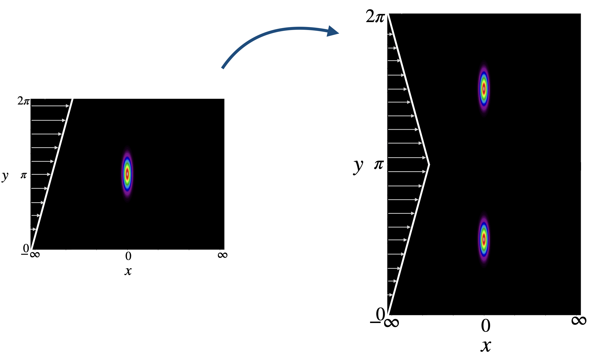

# StirMix

Computes exact solution to the initial value problem of the scalar tracer problem for a wide class of prescribed shear flows. The solutions are doubly periodic, but can be interpreted as **no-flux** in the cross-stream direction, and reentrant in the along-stream direction.

$$
\frac{\partial\theta}{\partial t} +  \mathbf{u}(x, y, t)\cdot\nabla\theta  = \nabla\cdot\left(\kappa(\mathbf{x},t)\nabla\theta \right) + \mathcal{S}(\mathbf{x}, t)
$$
in a doubly-periodic domain. Both $\mathbf{u}(\mathbf{x},t_0)$ and $\kappa(\mathbf{x},t_0)$ are prescribed (kinematic), piecewise integrable functions, and the initial condition should be able to be written as

with initial condition as a linear combination of separable functions according to
$$
\theta(\mathbf{x}, t=0) = \sum_{i}^{\infty}f_i(x)g_i(y)
$$
where both $f(x)$ and $g(y)$ are periodic, integrable functions with well-defined Fourier expansion. 

## Method of solution

Relies on the Green's Function of the problem above, which requires computing all the spectra necessary for a given domain. To compute the spectral, it makes use of the [HillsFunction.jl](https://github.com/Mikejmnez/HillFunctions.jl) library to compute the eigenvalue spectra associated with the (instantaneous) shear flow - diffusivity ($\kappa$) pair

$$
U(\chi, t_0) = \sum_{m=0}^{\infty}\alpha_{m}cos{(m\chi)}d\chi, \;\;\;\;\;\;\; \kappa(\chi, t_0) = \sum_{m=0}^{\infty}\beta_{m}cos{(m\chi)}d\chi
$$
Both shear flow $U(y)$ and $\kappa$ must be even function. If say $U$ is not even, then the solution is computed of the associated even periodic extension. 

### Associated even periodic extension
In the case the instantaneous parallel flow or diffusivity fields are an even functions at any given instant ($t=t_0$), the solution in this computational method computes the spectra of the even periodic extension $U^*(\chi)$ / $\kappa^*(\chi)$. In this case, the initial condition is modified by asl well, with shift in the cross-stream direction followed by the introduction of an image initial condition, equidistant to the half-distance in the cross-stream direction. Thus, the even-periodic extension solution produces the desired solution when only considering half of the domain.

